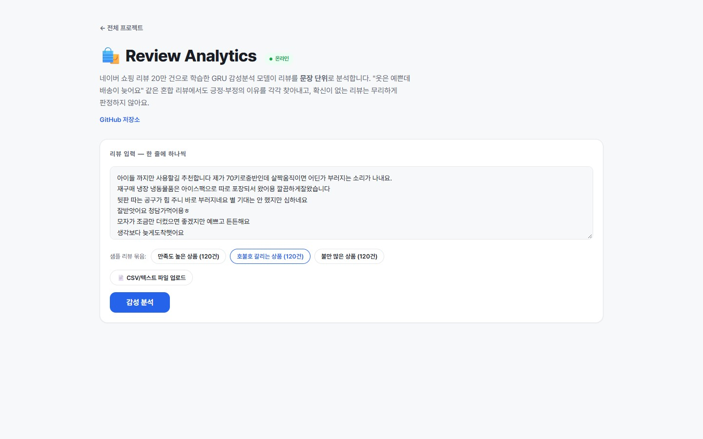
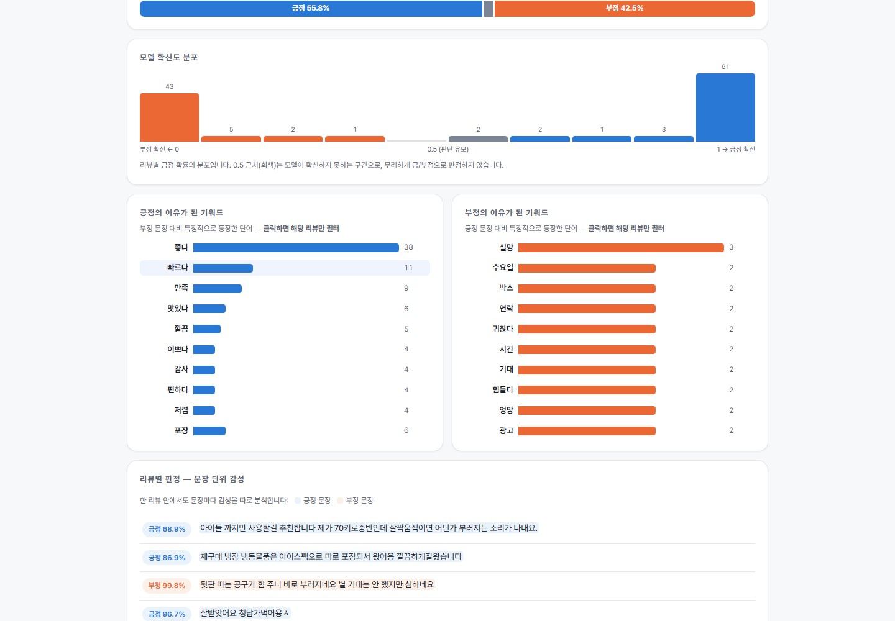
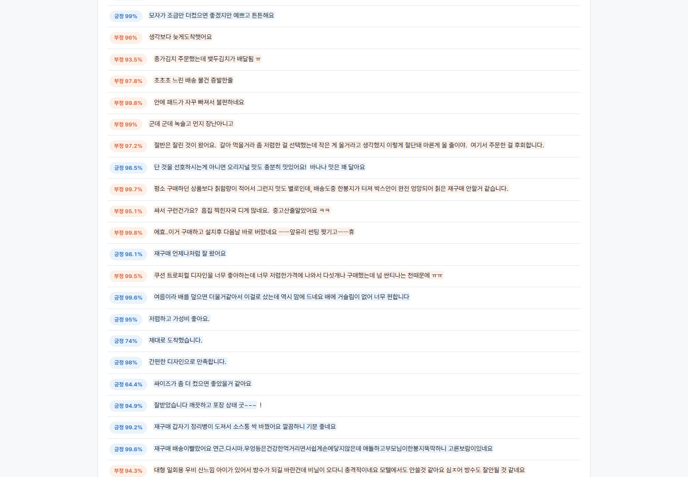

# 🛍️ 쇼핑몰 구매 리뷰 감성 분석 (Shopping-mall-Purchase-Review-Analytics)

> **별점 대신 리뷰 본문으로 상품의 실제 평가를 읽어냅니다.**
> **Project Date:** 2021.04 ~ 2021.05 · **3인 팀 프로젝트** (2026.06 CLI 리팩터링 · 2026.08 라이브 데모 현대화)
> **Platform:** Python CLI · Gradio API (Hugging Face Spaces) · Cloudflare 정적 프론트엔드
> **Live Demo:** [demo-gateway.trealight112.workers.dev/review-analytics](https://demo-gateway.trealight112.workers.dev/review-analytics/)
> **Role:** 리뷰 크롤링·정제 · GRU 모델 학습 · 긍/부정 키워드 도식화

**네이버 쇼핑 리뷰 20만 건**으로 학습한 **GRU(Gated Recurrent Unit)** 이진 분류기로 **무신사 상품 리뷰**를 감성 분석해, 상품별 **긍정/부정 비율**과 **감정별 대표 키워드**를 차트로 보여주는 파이프라인입니다.

Jupyter Notebook으로 동작하던 원 코드를 **모듈식 Python CLI**로 리팩터링했고, 같은 모델을 **Gradio API**로 노출해 브라우저에서 리뷰를 직접 입력해 볼 수 있는 라이브 데모로 서비스합니다.

---

## 📱 실제 화면

| 리뷰 입력 | 분석 결과 | 문장 단위 판정 |
|:---:|:---:|:---:|
|  |  |  |
| 샘플 리뷰 묶음을 고르거나 리뷰를 직접 붙여 넣어 분석 요청 | 모델 확신도 분포와 긍정·부정의 이유가 된 키워드 | 리뷰를 문장으로 나눠 문장마다 긍정·부정과 확신도 표시 |

---

## 📖 프로젝트 개요

별점은 "왜 좋은지, 왜 나쁜지"를 말해주지 않습니다. 이 프로젝트는 리뷰 본문을 직접 분류해 별점이 감추는 정보를 꺼냅니다.

* **별점이 아닌 본문 기준 비율** — 리뷰 문장을 GRU 모델로 분류해 실제 긍정/부정 비율을 계산
* **감정별 대표 키워드** — 긍정 리뷰와 부정 리뷰에서 각각 자주 나오는 단어를 뽑아 평가의 이유를 제시
* **학습 데이터와 분석 대상의 분리** — 학습은 네이버 쇼핑 리뷰 코퍼스, 분석 대상은 무신사에서 수집한 상품 리뷰

### 💡 주요 기능

| 기능 | 설명 |
|---|---|
| 🔍 **상품 리뷰 수집** | 키워드로 무신사 상품을 검색해 목록에서 고른 상품의 일반 리뷰와 포토/스타일 리뷰를 수집하고 CSV로 저장 |
| 🧠 **감성 분류** | 리뷰마다 긍정 확률(0~1)을 계산해 긍정/부정으로 분류 |
| 📊 **차트 생성** | 감성 비율 파이 차트, 긍정·부정 리뷰 핵심 키워드 막대 차트(상위 15개)를 PNG로 저장 |
| 🌐 **라이브 데모** | 리뷰 직접 입력·샘플 세트·CSV 업로드, 긍정/중립/부정 비율과 확신도 분포, 키워드 클릭 시 근거 리뷰 필터·하이라이트 |
| ✂️ **문장 단위 감성 분석** | 리뷰를 문장으로 나눠 각각 추론 — "옷은 예쁜데 배송이 늦어요"처럼 긍·부정이 섞인 리뷰도 문장별 감성을 색으로 표시 |
| ⚖️ **판단 유보(중립) 구간** | 긍정 확률 0.4~0.6 리뷰는 무리하게 판정하지 않고 중립으로 분류 |

---

## 🏗️ 아키텍처 — 2-티어 라이브 데모

정적 호스팅과 연산 서버를 분리했습니다. 화면은 Cloudflare가 서비스하고, GRU 추론은 Hugging Face Spaces의 Gradio API(`app.py`)가 맡습니다.

```text
[커스텀 프론트엔드]                             [백엔드 API]
Cloudflare (demo-gateway/review-analytics/) ──▶ Hugging Face Spaces (Gradio API)
리뷰 입력·샘플 세트·CSV 업로드,                 app.py — GRU 감성분석 모델을
긍정/중립/부정 비율·확신도 분포,                REST API로 노출 (CPU 추론)
키워드 클릭 → 근거 리뷰 필터·하이라이트,        문장 단위 배치 추론
문장 단위 감성 색칠
```

**요청 흐름 (리뷰 입력 → 분석 결과)**

1. 브라우저가 `@gradio/client`로 HF Space `kimjgwang/review-analytics`의 `analyze` API를 호출 (샘플 세트는 `samples` API)
2. 서버는 입력을 줄 단위 리뷰로 나누고, 한 번에 **최대 200건**까지만 받아 데모 서버를 보호
3. 리뷰 전체와, 리뷰를 문장으로 쪼갠 전체 문장을 각각 **한 번의 배치**로 추론
4. 긍정 확률 0.6 초과는 긍정, 0.4 미만은 부정, 그 사이는 중립으로 판정
5. 문장 감성을 기준으로 긍정·부정 키워드를 각각 상위 10개 뽑아 리뷰별 점수·확신도·문장별 감성과 함께 JSON으로 반환

> 추론은 CPU로 충분해 방문자별 GPU 쿼터를 쓰지 않도록 모든 처리를 CPU에서 실행하고, 화면과 연산 서버를 분리하는 구조로 결정했습니다.

### 데모를 위한 현대화 리팩터링 (2026.08)

| 변경 전 | 변경 후 | 이유 |
|---|---|---|
| `eunjeon` (Mecab) | `kiwipiepy` (Kiwi) | Windows/Linux 어디서나 순수 pip 설치 — 배포 가능성 확보 |
| Keras `Tokenizer` + `tokenizer.pickle` | 자체 `Vocabulary` + `vocab.json` | Keras 3에서 제거된 레거시 API 탈피, 버전 독립적 직렬화 |
| 리뷰 1건씩 추론 | 배치 추론 (`predict_scores`) | 리뷰 수백 건을 모델 호출 한 번으로 처리 |

---

## 🧠 감성 분석 파이프라인

수집 → 전처리 → 분류 → 시각화를 모듈로 나누고, `AnalysisPipeline`이 순서대로 실행합니다.

| 단계 | 모듈 | 내용 |
|---|---|---|
| **수집** | `src/crawler/musinsa.py` | 상품 검색과 ID 획득은 Selenium, 리뷰 수집은 무신사 내부 리뷰 API(`/api2/review/v1/view/list`)를 페이지당 20건씩 직접 호출 |
| **전처리** | `src/analyzer/sentiment.py` | 한글과 공백만 남기고 Kiwi로 형태소 분리 → 불용어 제거 → 정수 인코딩(길이 80, 앞쪽 패딩) |
| **모델** | `src/analyzer/sentiment.py` | Embedding(100차원) → GRU(128) → Dense(sigmoid). 별점 4점 이상을 긍정으로 라벨링, 검증 손실 기준 EarlyStopping·체크포인트 |
| **판정** | `src/analyzer/sentiment.py` · `app.py` | CLI는 긍정 확률 0.5 기준 긍/부정, 데모는 0.4~0.6을 중립으로 분리 |
| **키워드** | `src/visualization/plot.py` · `app.py` | CLI는 감성별 명사 빈도 상위 15개(브랜드명·상품명 제외), 데모는 반대 감성 대비 치우침(log-odds)으로 상위 10개 |
| **시각화** | `src/visualization/plot.py` | 감성 비율 파이 차트, 긍정·부정 키워드 막대 차트 |

### 확장성 설계 — 새 쇼핑몰 크롤러 추가

파이프라인은 특정 쇼핑몰이 아니라 [`BaseCrawler`](src/crawler/base.py) 인터페이스에 의존합니다. 이 추상 클래스를 상속해 세 메서드를 구현하고 `AnalysisPipeline`에 주입하면 다른 쇼핑몰에도 그대로 쓸 수 있습니다.

```python
# src/crawler/naver_shopping.py
from .base import BaseCrawler

class NaverShoppingCrawler(BaseCrawler):
    def search_products(self, keyword):
        ...  # 상품 검색 → [{'id', 'brand', 'name'}]

    def crawl_reviews(self, product_id, limit, has_photo=False):
        ...  # 리뷰 수집 → (별점 리스트, 리뷰 본문 리스트)

    def download_product_image(self, product_id, output_path):
        ...  # 대표 이미지 저장 → 저장 경로
```

---

## 📊 데이터 규모와 실측

| 단계 | 결과 |
|---|---|
| **학습 데이터** | 네이버 쇼핑 리뷰 **200,000건** → 중복 제거 후 유효 **199,908건** |
| **학습/평가 분할** | 학습 75% · 테스트 25% (학습분의 20%는 검증용) |
| **어휘 사전** | 2회 이상 등장한 단어만, 최대 20,000개 |
| **분류 정확도** | 2021년 원 모델 **92.5%** · Kiwi로 다시 학습한 데모 모델 테스트 정확도 **91.99%** |
| **데모 샘플 세트** | 학습 코퍼스에서 뽑은 120건짜리 3종 — 긍정:부정 102:18 · 66:54 · 30:90 |
| **데모 요청 한도** | 요청당 리뷰 최대 200건 |

---

## 🛠️ 기술 스택

| 영역 | 스택 |
|---|---|
| **언어** |  |
| **모델** |    Kiwi(`kiwipiepy`) 형태소 분석 |
| **수집** |  BeautifulSoup · requests |
| **분석·시각화** |   Matplotlib |
| **데모 서빙** |    |
| **인프라** |  |

---

## 💥 트러블 슈팅

### 1. 화면만 조작해서는 리뷰를 대량으로 모으기 어려웠다
* **현상:** 무신사는 URL이 바뀌지 않고 JavaScript로 화면만 전환되어, 주소를 바꿔 가며 페이지를 받는 방식으로는 리뷰를 수집할 수 없었음.
* **해결:** 처음에는 Selenium으로 브라우저를 제어해 추출했고, 리팩터링에서 검색과 상품 ID 획득만 Selenium에 남기고 리뷰는 무신사 내부 리뷰 API를 직접 호출하도록 바꿔 수집 속도를 10배 이상 높임.

### 2. 형태소 분석기가 배포 환경에 설치되지 않았다
* **현상:** 기존 `eunjeon`(Mecab)은 Windows와 서버 환경에서 설치가 어려워 데모를 배포할 수 없었음.
* **해결:** 순수 pip 패키지인 Kiwi(`kiwipiepy`)로 교체하고 모델을 다시 학습.

### 3. Keras 3에서 토크나이저가 사라졌다
* **현상:** 정수 인코딩에 쓰던 Keras `Tokenizer`가 Keras 3에서 제거되었고, `tokenizer.pickle`은 파이썬·케라스 버전에 묶여 있었음.
* **해결:** 토큰과 정수를 오가는 `Vocabulary` 클래스를 직접 만들고 `vocab.json`으로 저장해 버전과 무관하게 불러오도록 변경. 패딩 방식은 기존 `pad_sequences` 기본값(앞쪽 패딩)과 같게 유지.

### 4. 긍·부정이 섞인 리뷰에서 부정 근거가 사라졌다
* **현상:** "작아서 아쉬워요 ... 그래도 옷은 예뻐요" 같은 리뷰가 통째로 긍정으로 판정되면서 부정의 이유가 되는 단어가 키워드에서 빠짐.
* **원인:** 키워드를 리뷰 단위 감성으로 모았기 때문.
* **해결:** 리뷰를 문장으로 나눠 문장마다 추론하고, 키워드는 문장 감성 기준으로 집계. 마침표 없이 이어지는 리뷰에 대비해 종결부호와 `ㅠ`·`ㅜ` 뒤 공백에서도 문장을 분리하고, 중립 문장은 어느 쪽에도 넣지 않음.

### 5. 빈도순 키워드는 양쪽에 같은 단어가 올라왔다
* **현상:** "배송", "가격", "상품"처럼 긍정·부정 리뷰에 고르게 나오는 단어가 상위를 차지해 감성의 이유가 드러나지 않음.
* **해결:** 단순 빈도 대신 반대 감성 대비 얼마나 치우쳐 나오는지(log-odds)로 순위를 매기고, 한 문장에서 반복된 단어가 결과를 왜곡하지 않도록 문장당 1회만 세도록 변경. 감성의 이유는 형용사에 담기는 경우가 많아 명사 외에 형용사·어근도 키워드 후보에 포함.

### 6. 학습한 모델이 다른 환경에서 열리지 않을 수 있었다
* **현상:** 모델 역직렬화가 학습 당시 버전(TensorFlow 2.21 / Python 3.12)에 민감함.
* **해결:** `requirements.txt`에서 TensorFlow 버전을 고정하고, 같은 환경을 Dockerfile로 묶음. 학습된 모델은 용량 때문에 GitHub에 올리지 않고, 컨테이너 기동 시 HF Space 저장소에서 자동으로 받아오게 함.

---

## 📂 디렉터리 구조

```text
Shopping-mall-Purchase-Review-Analytics/
├── src/
│   ├── crawler/
│   │   ├── base.py             # 크롤러 추상 인터페이스 (BaseCrawler)
│   │   └── musinsa.py          # 무신사 크롤러 구현체 (MusinsaCrawler)
│   ├── analyzer/
│   │   └── sentiment.py        # 형태소 분석·어휘 사전·GRU 학습/추론 (SentimentModel)
│   ├── visualization/
│   │   └── plot.py             # 감성 비율·키워드 차트 (Visualizer)
│   └── pipeline.py             # 수집 → 분류 → 시각화 파이프라인 (AnalysisPipeline)
├── main.py                     # CLI 진입점 (train / analyze)
├── app.py                      # 라이브 데모용 Gradio API 서버 (HF Spaces 배포)
├── scripts/
│   └── prepare_demo_samples.py # 데모용 샘플 리뷰 세트 생성
├── assets/
│   └── demo_samples.json       # 데모용 샘플 리뷰 세트 (긍/부정 비율별 3종)
├── docker/
│   └── fetch_models.py         # 컨테이너 기동 시 HF에서 학습 모델 다운로드
├── docs/                       # 발표 자료
├── Dockerfile                  # 학습 환경(TF 2.21 / Python 3.12) 고정 이미지
├── requirements.txt            # 의존성 목록
│
│   # 실행 시 생성 (git 미추적)
├── models/                     # 학습된 모델(best_model.h5) · 어휘 사전(vocab.json)
└── data/                       # 수집한 리뷰 CSV · 상품 이미지 · 차트
```

---

## 🚀 실행 방법

**요구 사항:** Python 3.12 · Chrome (Selenium 수집용) 또는 Docker

### 도커로 데모 서버 실행 (권장)

학습 환경을 그대로 고정한 이미지이며, 학습된 모델은 기동 시 자동으로 받아옵니다.

```bash
docker build -t review-analytics .
docker run -p 7860:7860 review-analytics   # → http://localhost:7860
```

### 로컬 설치

```bash
python -m venv .venv
.venv\Scripts\activate           # macOS/Linux: source .venv/bin/activate
pip install -r requirements.txt
```

### CLI

```bash
python main.py train                                                 # GRU 모델 학습 (최초 1회)
python main.py analyze --keyword "데님" --limit 100                    # 검색 → 상품 번호 입력 → 분석
python main.py analyze --keyword "데님" --limit 100 --product-index 0  # 상품 번호 지정 (프롬프트 생략)
python app.py                                                        # 데모 API 서버 → http://localhost:7860
```

`train`은 학습 코퍼스를 자동으로 내려받아 `models/`에 `best_model.h5`와 `vocab.json`을 저장합니다. 이미 학습된 파일이 있으면 생략할 수 있습니다.

| 옵션 | 설명 |
|---|---|
| `-k`, `--keyword` | 쇼핑몰에서 검색할 키워드 (`analyze` 필수) |
| `-l`, `--limit` | 수집할 리뷰 개수 (기본값 `100`) |
| `-idx`, `--product-index` | 검색 결과 중 분석할 상품 번호 (0부터 시작) |
| `--no-headless` | Selenium Chrome 창을 실제로 띄워 실행 (디버깅용) |
| `-o`, `--out-dir` | CSV와 차트를 저장할 디렉터리 (기본값 `data`) |
| `-md`, `--model-dir` | 모델과 어휘 사전 경로 (기본값 `models`) |

### 결과물

분석이 끝나면 `data/<검색어>/` 아래에 다음 파일이 생성됩니다.

| 파일 | 내용 |
|---|---|
| `[상품명].jpg` | 대표 상품 이미지 |
| `[상품명]_general.csv` · `_photo.csv` · `_final.csv` | 일반 리뷰 · 포토/스타일 리뷰 · 전체 병합 리뷰 |
| `[상품명]_sentiment_ratio.png` | 감성 비율 파이 차트 |
| `[상품명]_positive_keywords.png` · `_negative_keywords.png` | 긍정 · 부정 리뷰 핵심 키워드 막대 차트 |

---

## 📚 문서

| 문서 | 내용 |
|---|---|
| [Introduction_to_Big_Data.pptx](docs/Introduction_to_Big_Data.pptx) | 프로젝트 발표 자료 |
| [demo-gateway](https://github.com/Kim-jin-gwang/demo-gateway) | 라이브 데모 프론트엔드 저장소 (`review-analytics/`) |

## 데이터 출처

- [네이버 쇼핑 리뷰 코퍼스](https://github.com/bab2min/corpus/tree/master/sentiment) (`naver_shopping.txt`) — 학습 데이터, 리뷰 20만 건
- [무신사](https://www.musinsa.com/) 상품 리뷰 — 분석 대상
